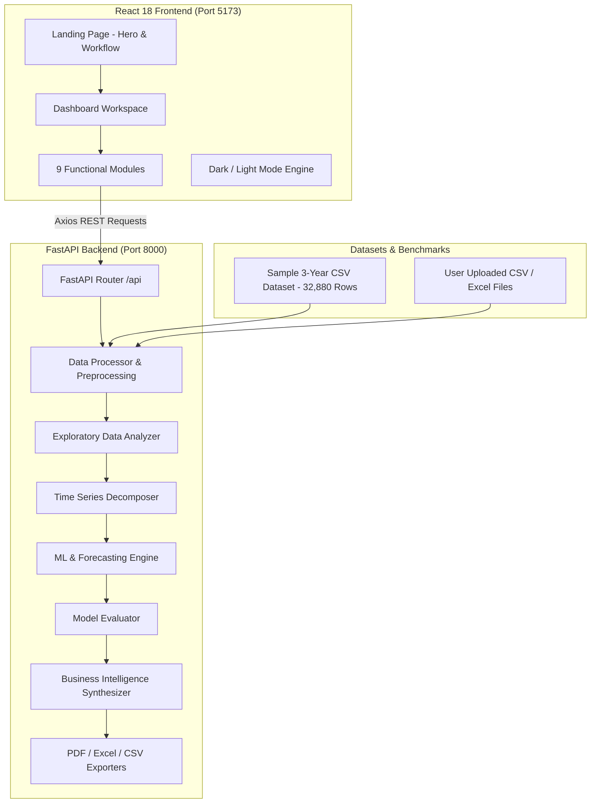

# Sales Forecasting System Using Machine Learning and Time Series Analysis

> **"Analyze Past Sales. Predict Future Growth."**

[](https://www.python.org/)
[](https://fastapi.tiangolo.com/)
[](https://react.dev/)
[](https://tailwindcss.com/)
[](https://recharts.org/)
[]()

---

## 📌 Project Overview

The **Sales Forecasting System** is a full-stack, enterprise-grade Data Analytics and Machine Learning web application designed for academic research (Bachelor of Engineering in Computer Science) and practical retail supply chain planning.

The platform ingests multi-year historical retail transactions, executes automated data cleaning, performs multi-dimensional Exploratory Data Analysis (EDA), decomposes time series components via statistical models, trains multiple supervised machine learning and autoregressive forecasting algorithms (Random Forest, Linear Regression, ARIMA, Moving Average), compares model performance across chronological out-of-sample test splits, dynamically synthesizes business intelligence insights, and exports publication-ready PDF, Excel, and CSV reports.

---

## 🛠️ Technology Stack

### Frontend
- **React.js 18** (Modern functional components, hooks)
- **Tailwind CSS 3.4** (Custom corporate navy blue & subtle purple styling, dark mode)
- **Recharts 2.12** (Interactive SVG time series charts, area graphs, bar charts, pie charts)
- **Lucide React** (Modern iconography)
- **Axios** (REST API communication)
- **Vite 5** (High-speed build engine & HMR)

### Backend
- **Python 3.11**
- **FastAPI** (High-throughput asynchronous REST API)
- **Uvicorn** (ASGI server)
- **Pydantic v2** (Type validation and schemas)

### Data Science & Machine Learning
- **Pandas 2.0+ & NumPy 1.24+** (Vectorized series preprocessing & transformations)
- **Scikit-learn 1.2+** (Random Forest Regressor, Ridge Linear Regression, MAE/MSE/RMSE metrics)
- **Statsmodels 0.14+** (ARIMA, `seasonal_decompose`, Augmented Dickey-Fuller stationarity test)
- **ReportLab 4.0+** (Academic & executive PDF report generator)
- **OpenPyXL 3.1+** (Multi-sheet Excel report workbook generator)

---

## 🏗️ System Architecture



---

## 📊 Core System Modules

### 1. Landing Page (Default Homepage)
- **Hero Section**: Introduces the project with the tagline *"Predict Tomorrow's Sales with Data-Driven Intelligence."* Includes interactive visual preview and CTA buttons.
- **Key Features**: 6 interactive feature cards (Sales Forecasting, Data Analytics, Machine Learning, Time Series Analysis, Interactive Visualization, Business Insights).
- **How It Works**: 6-step connecting scientific workflow pipeline.
- **Technologies**: Interactive badges for Python, React, FastAPI, Pandas, Scikit-learn, Statsmodels, and Recharts.
- **About Project**: Academic scope for BE Computer Science mini-project.
- **Footer**: Tagline, quick links, tech stack, copyright.

### 2. Dashboard Overview Module
- **6 Key Metrics**: Total Revenue, Total Units Sold, Total Products, Total Stores, Average Sales, Predicted Future Revenue.
- **Visuals**: Continuous sales trajectory with 7-day & 30-day moving averages, Store market share pie chart, Monthly revenue progression, Top-selling products.

### 3. Dataset Upload Module
- Supports **CSV** and **Excel (.xlsx, .xls)** formats with drag-and-drop.
- Auto-detects columns: `Date`, `Product_ID`, `Store_ID`, `Units_Sold`, `Revenue`, `Promotion`, `Holiday`.
- Reports total rows, columns, data types, missing values, duplicates, and record previews.
- **Built-in Benchmark**: One-click 3-year sample historical sales dataset generator (32,880 rows) with direct download option.

### 4. Data Preprocessing Module
- Missing value imputation (Forward Fill, Mean/Median, Drop).
- Duplicate removal and date chronology sorting.
- Outlier detection and capping via **Interquartile Range (IQR) Winsorization**:
  $$\text{Lower} = Q_1 - 2.5 \times \text{IQR}, \quad \text{Upper} = Q_3 + 2.5 \times \text{IQR}$$
- Real-time Before vs After data quality audit score.

### 5. Exploratory Data Analysis (EDA) Module
- **Temporal Analysis**: Daily, weekly (52-week), monthly (MoM growth), and yearly comparisons.
- **Seasonality Discovery**: Day-of-week seasonality (Mon-Sun) and month-of-year seasonal curves (Jan-Dec).
- **Extremes**: Top 5 peak trading dates and 5 lowest demand dates.
- **Portfolio Analytics**: Best-selling vs lowest-selling SKUs, revenue contributions, unit price estimations.
- **Store Benchmarks**: Store revenue comparisons and market share rankings.
- **Promotional & Holiday Lift**: Quantifiable percentage uplift calculated from trading days with/without promotions and holidays.

### 6. Time Series Analysis Module
- Statistical decomposition using Statsmodels into:
  1. **Observed Sales Series**
  2. **Trend Component** (Long-term secular expansion/contraction)
  3. **Seasonal Component** (Repeating cyclical periodic waves)
  4. **Residual / Noise Component** (Stochastic variations)
- **Augmented Dickey-Fuller (ADF) Test**:
  - Test Statistic, p-value, critical values (1%, 5%, 10%), number of observations.
  - Formally identifies stationarity ($p < 0.05$).

### 7. Machine Learning & Forecasting Module
- **Forecasting Models**:
  1. **Random Forest Regressor** (Ensemble of 100 estimators with lag 1, 2, 7, 14, rolling means, and calendar features)
  2. **Linear Regression (Ridge)** (L2 regularized model with cyclic features)
  3. **ARIMA(1,1,1)** (AutoRegressive Integrated Moving Average)
  4. **Moving Average (MA-7)** (Rolling window baseline)
- **Strict Chronological Train-Test Split (80/20)**: Zero lookahead bias.
- **Configurable Parameters**:
  - Frequency: Daily, Weekly, Monthly
  - Prediction Horizon: 7 days, 30 days, 3 months (90 days), 6 months (180 days)
  - Target Metric: Revenue ($) or Units Sold
  - Filtering: Portfolio-wide or sliced by specific Product ID or Store ID
- **Confidence Intervals**: 95% forecast probability bounds.

### 8. Model Evaluation Module
- Objective comparative table across all 4 models:
  - **MAE (Mean Absolute Error)**: $\frac{1}{n} \sum_{i=1}^n |y_i - \hat{y}_i|$
  - **MSE (Mean Squared Error)**: $\frac{1}{n} \sum_{i=1}^n (y_i - \hat{y}_i)^2$
  - **RMSE (Root Mean Squared Error)**: $\sqrt{\frac{1}{n} \sum_{i=1}^n (y_i - \hat{y}_i)^2}$
- Identifies and highlights the **Optimal Performance Champion** based on lowest RMSE.

### 9. Business Insights Module
- Synthesizes data-backed strategic intelligence:
  - Top revenue contributor and slow-moving SKU warnings.
  - Store outlet performance disparities.
  - Promotional campaign ROI uplift percentage.
  - Holiday surge planning triggers.
  - Weekly staffing rhythms based on peak days.
  - Predictive demand growth expectations.
  - **Inventory Replenishment Guide**: Safety stock buffers and reorder lead times.

### 10. Analytical Report Generation Module
- **PDF Academic Report**: Formatted multi-page publication document built with ReportLab including Executive Summary, KPIs, Model Comparison, Forecast Table, and Strategic Insights.
- **Excel Multi-Sheet Workbook (.xlsx)**: Worksheets for Executive Summary, Sales Forecast, Product Analytics, Store Analytics, and Cleaned Data.
- **CSV Forecast Export**: Downloadable predictions with confidence intervals for ERP integration.

---

## 🚀 Quick Start Guide

### Option 1: One-Click Windows Launchers (Recommended)
1. Double-click `run_project.bat` (or execute `.\run_project.ps1` in PowerShell).
2. The launcher starts the FastAPI backend on `http://127.0.0.1:8000` and the React frontend on `http://localhost:5173`.
3. Open your browser at **`http://localhost:5173`**.

---

### Option 2: Manual Terminal Commands

#### Terminal 1 — Backend (FastAPI)
```powershell
cd "c:\Users\Simran Annigeri\Desktop\sales forecasting\backend"
.\venv\Scripts\python.exe run.py
```
*Backend runs on `http://127.0.0.1:8000` (API Docs at `http://127.0.0.1:8000/docs`).*

#### Terminal 2 — Frontend (React Vite)
```powershell
cd "c:\Users\Simran Annigeri\Desktop\sales forecasting\fronten
npm run dev
```
*Frontend runs on `http://localhost:5173`.*

---

## 📡 API Endpoints Reference

| Method | Endpoint | Description |
| :--- | :--- | :--- |
| `GET` | `/api/health` | Service health status & active dataset flags |
| `GET` | `/api/sample/generate` | Generates & loads 3-year sample historical data |
| `GET` | `/api/sample/download` | Direct download of sample sales CSV file |
| `POST` | `/api/dataset/upload` | Multipart upload for CSV & Excel (.xlsx, .xls) |
| `POST` | `/api/dataset/preprocess` | Executes Pandas cleaning & outlier Winsorization |
| `GET` | `/api/dataset/eda` | Returns complete exploratory statistics & distributions |
| `POST` | `/api/timeseries/decompose` | Statsmodels seasonal decomposition & ADF test |
| `POST` | `/api/forecasting/train-predict` | Trains specified model & predicts future horizon |
| `POST` | `/api/forecasting/compare-all` | Evaluates all 4 models on chronological test split |
| `GET` | `/api/insights` | Generates dynamic business & inventory takeaways |
| `GET` | `/api/reports/download-pdf` | Exports formatted academic PDF analytical report |
| `GET` | `/api/reports/download-excel` | Exports multi-sheet Excel workbook (.xlsx) |
| `GET` | `/api/reports/download-csv` | Exports forecast predictions CSV |

---

## 🎓 Academic Mini-Project Suitability

This project strictly satisfies all requirements for a **Bachelor of Engineering Computer Science** mini-project:
1. **No Synthetic / Hardcoded Predictions**: Every forecast, metric, and percentage is computed directly on the active dataset in Python.
2. **Methodological Integrity**: Chronological train-test splitting without lookahead data leakage.
3. **Statistical Depth**: Stationarity testing via Augmented Dickey-Fuller and seasonal decomposition via Statsmodels.
4. **Ensemble & Autoregressive Breadth**: Direct empirical comparison between machine learning (Random Forest, Ridge Regression) and time series statistics (ARIMA, Moving Average).
5. **Business Decision Value**: Bridges predictive numbers with real-world inventory recommendations and formatted deliverables.


## live project deployment
Live Website - https://vercel.com/simran-s-projects80/sales-forecasting-frontend


